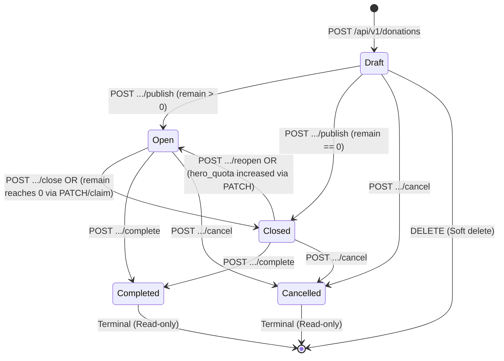

# API Contract: Donations & Food Distribution Management

> **Document Version:** `1.0.0`  
> **Topic ID:** `013`  
> **Base Path:** `/api/v1`  
> **Security:** Bearer JWT (`Authorization: Bearer <token>`) & Optional Bearer token for public read endpoints  
> **Rate Limiting:** Token Bucket (60 req/min per IP)  
> **Specification Format:** REST / JSON  

---

## 1. Global Standards & Conventions

### 1.1 Headers

| Header | Direction | Type | Description |
| :--- | :--- | :--- | :--- |
| `Content-Type` | Request / Response | String | `application/json; charset=utf-8` |
| `Authorization` | Request | String | `Bearer <access_token>` (Required for mutating endpoints and staff reads; optional for public reads) |
| `X-Request-Id` | Request / Response | String | Correlation ID format `ref_<hex>` (e.g. `ref_f5181fb0`). Propagated or auto-generated. |
| `Retry-After` | Response | Integer | Wait time in seconds when HTTP 429 is encountered. |

### 1.2 Response Envelopes

#### Standard Success (`200 OK`, `201 Created`)
```json
{
  "status": "success",
  "message": "Human-readable description of the completed action",
  "data": {}
}
```

#### Paginated Success (`200 OK`)
```json
{
  "status": "success",
  "message": "Donations retrieved successfully",
  "data": [],
  "meta": {
    "page": 1,
    "limit": 10,
    "total": 42,
    "total_pages": 5
  }
}
```

#### Error Envelope (`4xx`, `5xx`)
```json
{
  "status": "error",
  "code": "ERROR_CODE_STRING",
  "message": "Safe human-readable summary of the error",
  "ref_id": "ref_a2a590df",
  "errors": {
    "field_name": "Specific actionable message for this field"
  }
}
```

---

## 2. Endpoints Overview

| Method | Endpoint | Auth | Role Guardrails | Description |
| :--- | :--- | :--- | :--- | :--- |
| `GET` | `/api/v1/donations` | Optional Bearer | Public / Hero / Staff | List donations. Public callers receive active and recent past (within 72h window) distributions; staff callers view all statuses with search and status filters. |
| `GET` | `/api/v1/donations/:id` | Optional Bearer | Public / Hero / Staff | Retrieve a single donation by UUID. Drafts, hidden distributions, and past distributions older than 72h are restricted to staff. |
| `POST` | `/api/v1/donations` | Bearer JWT | Operational (`division_id = 3`) or `super` | Create a new donation in `draft` status with associated foods and beneficiary category targets. |
| `PATCH` | `/api/v1/donations/:id` | Bearer JWT | Operational (`division_id = 3`) or `super` | Safe partial update of a donation. Completed and cancelled donations are immutable (`400 VAL_001`). |
| `DELETE` | `/api/v1/donations/:id` | Bearer JWT | Operational (`division_id = 3`) or `super` | Soft delete a donation (`deleted_at = NOW()`). Allowed only while in `draft` status (`400 VAL_001`). |
| `POST` | `/api/v1/donations/:id/publish` | Bearer JWT | Operational (`division_id = 3`) or `super` | Publish a `draft` donation. Transitions to `open` (or `closed` if `remain == 0`). |
| `POST` | `/api/v1/donations/:id/close` | Bearer JWT | Operational (`division_id = 3`) or `super` | Manually close an `open` donation before its scheduled event time. |
| `POST` | `/api/v1/donations/:id/reopen` | Bearer JWT | Operational (`division_id = 3`) or `super` | Reopen a `closed` donation if `remain > 0` and event datetime is in the future. |
| `POST` | `/api/v1/donations/:id/complete` | Bearer JWT | Operational (`division_id = 3`) or `super` | Mark an `open` or `closed` distribution as `completed` (terminal state). |
| `POST` | `/api/v1/donations/:id/cancel` | Bearer JWT | Operational (`division_id = 3`) or `super` | Cancel a `draft`, `open`, or `closed` distribution (terminal state). |

---

## 3. Endpoint Specifications

### 3.1 List Donations

Retrieves a paginated list of food donations.
- **Public & Hero Callers:** Can query `?status=open` (active distributions, open + full/closed) or `?status=past` (completed distributions within the 72-hour window). Masked sponsors render as `"Generous sponsor"` without ID or logo. Phone, email, and address of sponsors are strictly excluded. Hidden beneficiary categories are omitted.
- **Staff Callers:** Can query any status (`draft`, `open`, `closed`, `completed`, `cancelled`) or leave `status` empty to view all records, with case-insensitive search by message or address.

* **Method:** `GET`
* **Path:** `/api/v1/donations`
* **Authentication:** Optional (`Bearer <JWT>`)
* **Role Permissions:** Public access permitted. Staff callers receive staff response view.

#### Query Parameters

| Parameter | Type | Required | Default | Description |
| :--- | :--- | :--- | :--- | :--- |
| `page` | integer | No | `1` | 1-indexed page number (must be > 0). |
| `limit` | integer | No | `10` | Records per page (maximum `100`). |
| `status` | string | No | `open` (public) / `all` (staff) | Filter by status. Public callers accept `open` or `past`. Staff accept any status. |
| `search` | string | No | `null` | Substring match against address and message (staff only). |

#### Responses

##### `200 OK` (Public Caller View)
```json
{
  "status": "success",
  "message": "Donations retrieved successfully",
  "data": [
    {
      "id": "11111111-2222-3333-4444-555555555555",
      "event_at": "2026-11-20T10:00:00Z",
      "hero_quota": 25,
      "remain": 10,
      "is_full": false,
      "address": "Jl. Kaliurang KM 5, Sleman",
      "maps": "https://maps.google.com/?q=-7.76,110.38",
      "message": "Pengambilan makanan di dekat gerbang barat.",
      "status": "open",
      "created_at": "2026-11-12T10:00:00Z",
      "updated_at": "2026-11-12T10:00:00Z",
      "sponsor": {
        "id": "87acbb21-a5b2-4d99-8511-48cb43253df7",
        "name": "PT Berbagi Bites Jogja",
        "logo": "https://cdn.example.com/files/logo.png"
      },
      "foods": [
        {
          "food_item_id": 1,
          "name": "Nasi Kotak Ayam Bakar",
          "quantity": 50.0,
          "unit": "portion"
        }
      ],
      "targets": [
        {
          "beneficiary_category_id": "99999999-0000-0000-0000-000000000001",
          "name": "Mahasiswa UGM",
          "variant": "hero"
        }
      ]
    }
  ],
  "meta": {
    "page": 1,
    "limit": 10,
    "total": 1,
    "total_pages": 1
  }
}
```

##### `200 OK` (Staff Caller View)
Staff callers receive additional fields: `quota`, `hide_from_public`, `hide_sponsor`, `created_by`, and full sponsor contact information (`email`, `phone`, `address`, `hidden`, `hide_donations`).
```json
{
  "status": "success",
  "message": "Donations retrieved successfully",
  "data": [
    {
      "id": "11111111-2222-3333-4444-555555555555",
      "event_at": "2026-11-20T10:00:00Z",
      "quota": 50,
      "hero_quota": 25,
      "remain": 10,
      "address": "Jl. Kaliurang KM 5, Sleman",
      "maps": "https://maps.google.com/?q=-7.76,110.38",
      "message": "Pengambilan makanan di dekat gerbang barat.",
      "status": "open",
      "hide_from_public": false,
      "hide_sponsor": false,
      "created_at": "2026-11-12T10:00:00Z",
      "updated_at": "2026-11-12T10:00:00Z",
      "sponsor": {
        "id": "87acbb21-a5b2-4d99-8511-48cb43253df7",
        "name": "PT Berbagi Bites Jogja",
        "logo": "88888888-0000-0000-0000-000000000001",
        "hidden": false,
        "hide_donations": false,
        "email": "csr@bbj.com",
        "phone": "6281234567890",
        "address": "Sleman, Yogyakarta"
      },
      "created_by": {
        "id": "00000000-0000-0000-0000-000000000007",
        "email": "op.sf@berbagibitesjogja.com"
      },
      "foods": [
        {
          "food_item_id": 1,
          "name": "Nasi Kotak Ayam Bakar",
          "quantity": 50.0,
          "unit": "portion"
        }
      ],
      "targets": [
        {
          "beneficiary_category_id": "99999999-0000-0000-0000-000000000001",
          "name": "Mahasiswa UGM",
          "variant": "hero"
        }
      ]
    }
  ],
  "meta": {
    "page": 1,
    "limit": 10,
    "total": 1,
    "total_pages": 1
  }
}
```

---

### 3.2 Get Donation by ID

Retrieves full details for a single active donation.
- **Public & Hero Callers:** Receive `404 Not Found` if status is `draft`, `cancelled`, or `hide_from_public = true`, or if `status = completed` and the event is older than 72 hours.
- **Staff Callers:** Can inspect any active donation in any status.

* **Method:** `GET`
* **Path:** `/api/v1/donations/:id`
* **Authentication:** Optional (`Bearer <JWT>`)

#### Path Parameters

| Parameter | Type | Required | Description |
| :--- | :--- | :--- | :--- |
| `id` | string (UUID) | **Yes** | Unique identifier of the donation. |

#### Responses

* `200 OK`: Returns public or staff response representation according to caller role.
* `400 Bad Request` (`VAL_001`): Invalid UUID format.
* `404 Not Found` (`NOT_FOUND`): Donation not found, deleted, or restricted by visibility/status rules.

---

### 3.3 Create Donation

Creates a new food distribution event. Newly created donations start in `draft` status.

* **Method:** `POST`
* **Path:** `/api/v1/donations`
* **Authentication:** Required (`Bearer <JWT>`)
* **Role Permissions:** Operational staff (`division_id = 3`) or Super Admin (`role = super`). Other staff divisions receive `403 Forbidden`.

#### Request Body
```json
{
  "sponsor_id": "87acbb21-a5b2-4d99-8511-48cb43253df7",
  "event_at": "2026-11-20T10:00:00Z",
  "quota": 50,
  "hero_quota": 25,
  "address": "Di UGM, Sleman",
  "maps": "https://maps.google.com/?q=-7.76,110.38",
  "message": "Masuk gerbang utama belok kanan",
  "hide_from_public": false,
  "hide_sponsor": false,
  "foods": [
    {
      "food_item_id": 1,
      "quantity": 50.0,
      "unit": "portion"
    }
  ],
  "beneficiary_category_ids": [
    "99999999-0000-0000-0000-000000000001"
  ]
}
```

| Field | Type | Required | Rules & Constraints |
| :--- | :--- | :--- | :--- |
| `sponsor_id` | string (UUID) | **Yes** | Must reference an active, non-deleted sponsor in `sponsors(id)`. |
| `event_at` | string (RFC3339) | **Yes** | Scheduled distribution datetime in valid RFC3339 format. |
| `quota` | integer | **Yes** | Total meal portions available. Must be `> 0`. |
| `hero_quota` | integer | No | Quota allocated for individual Hero claims. Must be `>= 0` and `<= quota`. Defaults to `0`. If all target categories are `organization`, must strictly be `0`. |
| `address` | string | No | Physical venue address. Max 500 characters. |
| `maps` | string | No | Google Maps / GPS link. |
| `message` | string | No | Freeform staff notes or instructions for beneficiaries. |
| `hide_from_public` | boolean | No | When `true`, completely hides the donation from public/hero views. Defaults to `true`. |
| `hide_sponsor` | boolean | No | When `true`, masks sponsor to `"Generous sponsor"` for this specific event. Defaults to `false`. |
| `foods` | array of objects | **Yes** | At least 1 food item required. Cannot contain duplicate `food_item_id`s. |
| `foods[].food_item_id` | integer | **Yes** | Must reference an existing record in `food_items(id)`. |
| `foods[].quantity` | float | **Yes** | Amount of food. Must be `> 0`. |
| `foods[].unit` | string | **Yes** | One of: `kg`, `g`, `l`, `ml`, `portion`, `pack`, `piece`. |
| `beneficiary_category_ids` | array of UUIDs | **Yes** | At least 1 category UUID required. Cannot contain duplicate IDs. |

#### Responses

##### `201 Created`
```json
{
  "status": "success",
  "message": "Donation created successfully",
  "data": {
    "id": "11111111-2222-3333-4444-555555555555",
    "event_at": "2026-11-20T10:00:00Z",
    "quota": 50,
    "hero_quota": 25,
    "remain": 25,
    "address": "Di UGM, Sleman",
    "maps": "https://maps.google.com/?q=-7.76,110.38",
    "message": "Masuk gerbang utama belok kanan",
    "status": "draft",
    "hide_from_public": false,
    "hide_sponsor": false,
    "created_at": "2026-11-12T14:00:00Z",
    "updated_at": "2026-11-12T14:00:00Z",
    "sponsor": {
      "id": "87acbb21-a5b2-4d99-8511-48cb43253df7",
      "name": "PT Berbagi Bites Jogja",
      "logo": null,
      "hidden": false,
      "hide_donations": false,
      "email": "csr@bbj.com",
      "phone": "6281234567890",
      "address": "Sleman, Yogyakarta"
    },
    "created_by": {
      "id": "00000000-0000-0000-0000-000000000007",
      "email": "op.sf@berbagibitesjogja.com"
    },
    "foods": [
      {
        "food_item_id": 1,
        "name": "Ayam Goreng",
        "quantity": 50.0,
        "unit": "portion"
      }
    ],
    "targets": [
      {
        "beneficiary_category_id": "99999999-0000-0000-0000-000000000001",
        "name": "Mahasiswa UGM",
        "variant": "hero"
      }
    ]
  }
}
```

* `400 Bad Request` (`VAL_001`): Field validation failed (e.g. `quota <= 0`, `hero_quota > quota`, negative values).
* `400 Bad Request` (`VAL_002`): Foreign key constraint violation (sponsor or food item does not exist).
* `403 Forbidden` (`AUTH_002`): Caller is not an operational staff member or super admin.

---

### 3.4 Update Donation

Performs a safe partial update (`PATCH`) on a donation record. Fields omitted from the payload retain their existing values.
- **State Guardrail:** Donations in terminal states (`completed`, `cancelled`) are strictly immutable and return `400 VAL_001`.
- **Remain Recalculation:** If `hero_quota` is updated, `remain` is recalculated as `remain = new_hero_quota - claimed_count`. If `remain < 0`, the request is rejected with `400 VAL_001`.
- **Auto-Close & Auto-Reopen:**
  - If decreasing `hero_quota` causes `remain` to reach `0` on an `open` donation, status automatically switches to `closed`.
  - If increasing `hero_quota` on a `closed` donation results in `remain > 0` and the event is in the future, status automatically switches to `open`.

* **Method:** `PATCH`
* **Path:** `/api/v1/donations/:id`
* **Authentication:** Required (`Bearer <JWT>`)
* **Role Permissions:** Operational staff (`division_id = 3`) or Super Admin (`role = super`).

#### Request Body
```json
{
  "quota": 60,
  "hero_quota": 30,
  "message": "Pembaruan petunjuk lokasi pengambilan."
}
```

#### Responses

* `200 OK`: Donation updated successfully with updated response payload.
* `400 Bad Request` (`VAL_001`): Validation failure, terminal state guard violation, or quota invariant breach.
* `400 Bad Request` (`VAL_002`): Referenced entity does not exist.
* `404 Not Found` (`NOT_FOUND`): Donation not found or soft-deleted.

---

### 3.5 Delete Donation

Performs a soft delete (`deleted_at = NOW()`) on a donation.

* **Method:** `DELETE`
* **Path:** `/api/v1/donations/:id`
* **Authentication:** Required (`Bearer <JWT>`)
* **Role Permissions:** Operational staff (`division_id = 3`) or Super Admin (`role = super`).
* **State Guardrail:** Soft deletion is strictly permitted **only when `status = draft`**. Deleting an `open`, `closed`, `completed`, or `cancelled` donation is rejected with `400 VAL_001`.

#### Responses

##### `200 OK`
```json
{
  "status": "success",
  "message": "Donation deleted successfully",
  "data": {
    "id": "11111111-2222-3333-4444-555555555555"
  }
}
```

* `400 Bad Request` (`VAL_001`): Cannot delete non-draft donation.
* `404 Not Found` (`NOT_FOUND`): Donation not found or already deleted.

---

### 3.6 Donation Lifecycle Action Endpoints

Lifecycle actions represent discrete state transitions that validate specific business prerequisites and trigger audit events.

#### 3.6.1 Publish Donation
Transitions a `draft` donation into `open` (or `closed` if `hero_quota > 0` and `remain == 0`).
* **Method:** `POST`
* **Path:** `/api/v1/donations/:id/publish`
* **Prerequisites:**
  1. Current status must be `draft`.
  2. Scheduled `event_at` must be strictly in the future (`> NOW()`).
  3. At least one food item must be attached.
  4. If all target categories are `organization`, `hero_quota` must be `0`.

#### 3.6.2 Close Donation
Manually closes an `open` donation, preventing further beneficiary claims before the event begins.
* **Method:** `POST`
* **Path:** `/api/v1/donations/:id/close`
* **Prerequisites:** Current status must be `open`.

#### 3.6.3 Reopen Donation
Reopens a previously `closed` donation.
* **Method:** `POST`
* **Path:** `/api/v1/donations/:id/reopen`
* **Prerequisites:**
  1. Current status must be `closed`.
  2. `remain` must be `> 0`.
  3. Scheduled `event_at` must be in the future (`> NOW()`).

#### 3.6.4 Complete Donation
Marks a distribution as successfully executed and completed.
* **Method:** `POST`
* **Path:** `/api/v1/donations/:id/complete`
* **Prerequisites:** Current status must be `open` or `closed`.

#### 3.6.5 Cancel Donation
Aborts a scheduled or in-progress food distribution.
* **Method:** `POST`
* **Path:** `/api/v1/donations/:id/cancel`
* **Prerequisites:** Current status must be `draft`, `open`, or `closed`. Already `completed` donations cannot be cancelled (`400 VAL_001`).

---

## 4. Domain Invariants & State Machine

### 4.1 State Machine



### 4.2 State Transition Matrix

| From \ To | `draft` | `open` | `closed` | `completed` | `cancelled` | Soft Delete |
| :--- | :---: | :---: | :---: | :---: | :---: | :---: |
| **`draft`** | — | Allowed (Publish) | Allowed (Publish if remain=0) | Forbidden | Allowed (Cancel) | Allowed |
| **`open`** | Forbidden | — | Allowed (Close / Auto) | Allowed (Complete) | Allowed (Cancel) | Forbidden |
| **`closed`** | Forbidden | Allowed (Reopen / Auto) | — | Allowed (Complete) | Allowed (Cancel) | Forbidden |
| **`completed`** | Forbidden | Forbidden | Forbidden | — | Forbidden | Forbidden |
| **`cancelled`** | Forbidden | Forbidden | Forbidden | Forbidden | — | Forbidden |

### 4.3 Quota Invariants
1. **Total Quota:** `quota > 0` at all times.
2. **Hero Allocation:** `0 <= hero_quota <= quota`.
3. **Remaining Calculation:** `remain = hero_quota - claimed_count`.
4. **Non-Negative Remain:** An update that would cause `remain < 0` (e.g. lowering `hero_quota` below existing claims) is immediately rejected.
5. **Quota Penuh Badge (`is_full`):** Displayed as `true` in public views whenever `remain == 0` or `status = closed`.

### 4.4 Triple Privacy Masking (Section 6.4)
A sponsor is masked to `"Generous sponsor"` (with `id = null` and `logo = null`) on public and hero endpoints if **any** of the following three conditions are met:
1. `donations.hide_sponsor = true` (per-event masking selected by staff).
2. `sponsors.hidden = true` (entire sponsor profile is unlisted/hidden).
3. `sponsors.hide_donations = true` (sponsor profile is public, but their distributions default to anonymous).

Under no circumstances are a sponsor's `phone`, `email`, or `address` returned to public or hero callers.

---

## 5. Error Code Reference

| Code | HTTP Status | Meaning |
| :--- | :--- | :--- |
| `VAL_001` | `400 Bad Request` | Validation failure (malformed payload, invalid format, out-of-range value, or state transition violation). |
| `VAL_002` | `400 Bad Request` | Foreign key or uniqueness constraint conflict (non-existent sponsor, food item, or beneficiary category). |
| `AUTH_001` | `401 Unauthorized` | Missing, expired, or malformed JWT access token. |
| `AUTH_002` | `403 Forbidden` | Insufficient permissions (e.g., non-operational staff mutating donations, or public accessing draft). |
| `NOT_FOUND` | `404 Not Found` | The requested donation ID does not exist, has been soft deleted, or is hidden from public callers. |
| `ERR_INTERNAL` | `500 Internal Server Error` | Unexpected server or database exception. Details safe-logged with `ref_id`. |
