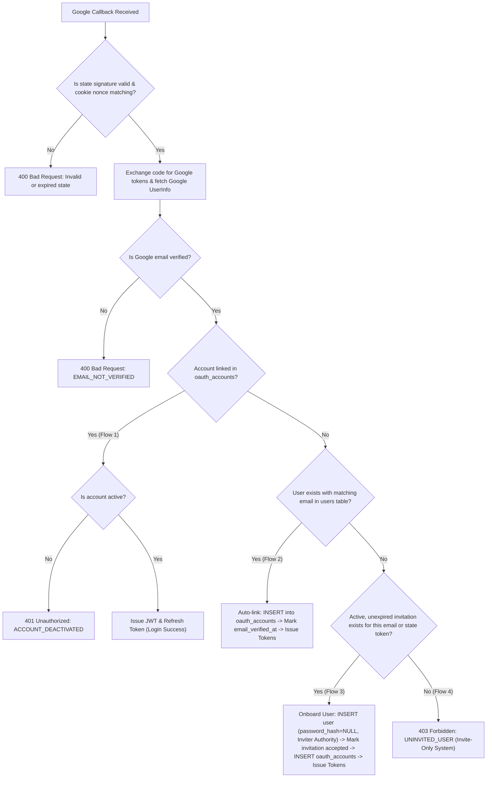

# API Contract: Google OAuth2 Authentication & Invite-Only Onboarding

> **Document Version:** `1.0.0`  
> **Topic ID:** `003`  
> **Base Path:** `/api/v1`  
> **Protocol:** OAuth 2.0 Authorization Code Flow + OpenID Connect  
> **Specification Format:** REST / JSON / HTTP 307 Redirects  

---

## 1. Global Standards & Conventions

### 1.1 Headers & Cookies

| Parameter / Header | Type | Direction | Description |
| :--- | :--- | :--- | :--- |
| `X-Request-Id` | String | Request / Response | Correlation ID format `ref_<hex>`. Included in all JSON response envelopes as `ref_id`. |
| `oauth_state` | Cookie | Response / Request | Short-lived HTTP-only cookie (`Max-Age=600`, `SameSite=Lax`, `Path=/`) storing the 16-byte random state nonce to prevent OAuth CSRF attacks. |
| `Accept` | Header | Request | If set to `application/json`, forces the callback to output JSON envelopes instead of redirecting to the frontend. |

### 1.2 Response Envelopes

#### JSON Success Envelope (`200 OK`)
```json
{
  "status": "success",
  "message": "Login successful",
  "data": {
    "access_token": "eyJhbGciOiJIUzI1NiIsInR5cCI6IkpXVCJ9...",
    "refresh_token": "36d36c9872ff47858a799a661ac0b485ffe38fb6b95d8ad437c0cd9aa876e591",
    "expires_in": 900,
    "user": {
      "id": "cedbdaa3-d5d3-4dca-a63b-01a2b36ac85f",
      "email": "sarah.core@berbagibitesjogja.com",
      "role": "core",
      "division_id": 2,
      "name": "Sarah Jenkins",
      "phone_number": "6281234567890",
      "is_active": true,
      "email_verified_at": "2026-10-31T09:30:00+07:00"
    }
  }
}
```

#### JSON Error Envelope (`4xx`, `5xx`)
```json
{
  "status": "error",
  "code": "ERROR_CODE_STRING",
  "message": "Safe human-readable summary of the error",
  "ref_id": "ref_67722025"
}
```

---

## 2. Endpoints Overview

| Method | Endpoint | Auth | Purpose |
| :--- | :--- | :--- | :--- |
| `GET` | `/api/v1/auth/google/login` | Public | Generates CSRF state, sets cookie, and redirects user to Google Consent |
| `GET` | `/api/v1/auth/google/callback` | Public | Validates code & state, handles linking/onboarding, delivers auth tokens |

---

## 3. Endpoint Specifications

### 3.1 Google Login (`GET /api/v1/auth/google/login`)

Initiates the Google OAuth2 authorization flow. Cryptographically generates an HMAC-SHA256 signed `state` carrying an optional invitation token, stores the nonce in an `oauth_state` HTTP-only cookie, and redirects the client to Google's consent page.

* **Method:** `GET`
* **Path:** `/api/v1/auth/google/login`
* **Authentication:** None (Public)

#### Query Parameters
| Parameter | Type | Required | Description |
| :--- | :--- | :--- | :--- |
| `invitation_token` | string | No | Raw 64-character invitation hex token if an invited user is registering via Google from their invitation link. |

#### Responses

##### `307 Temporary Redirect` (Success)
* **Headers:**
  * `Location`: `https://accounts.google.com/o/oauth2/auth?client_id=...&redirect_uri=...&response_type=code&scope=openid+email+profile&state=<signed_state>`
  * `Set-Cookie`: `oauth_state=<nonce>; Path=/; Max-Age=600; HttpOnly; SameSite=Lax`
  * `X-Request-Id`: `ref_<hex>`

##### `500 Internal Server Error` (Unconfigured)
Returned if Google OAuth credentials (`GOOGLE_CLIENT_ID` or `GOOGLE_CLIENT_SECRET`) are missing.
```json
{
  "status": "error",
  "code": "INTERNAL_ERROR",
  "message": "Google OAuth is not configured on this server",
  "ref_id": "ref_e8912bfa"
}
```

---

### 3.2 Google Callback (`GET /api/v1/auth/google/callback`)

Handles the return redirect from Google's OAuth consent screen. Exchanges the authorization `code` for Google OAuth tokens, fetches the user's verified OpenID profile, and resolves authentication across 4 deterministic flows.

* **Method:** `GET`
* **Path:** `/api/v1/auth/google/callback`
* **Authentication:** None (Public)

#### Query Parameters
| Parameter | Type | Required | Description |
| :--- | :--- | :--- | :--- |
| `code` | string | **Yes** | Temporary authorization code issued by Google. |
| `state` | string | **Yes** | Signed HMAC-SHA256 state token returned by Google. |
| `format` | string | No | Pass `format=json` to force direct JSON output instead of frontend redirection. |

---

### 3.3 Authentication & Linking State Machine



#### Precedence Hierarchy (Inviter Authority)
When onboarding a user from an invitation via Google OAuth (Flow 3):
1. **Email:** Must match both the invitation record and Google's verified email.
2. **Role & Division:** Strictly derived from `user_invitations` (`invite.role`, `invite.division_id`).
3. **Name:** If the inviter specified a name (`invite.name`), it takes precedence over Google's display name (`google.name`).
4. **Phone Number:** If the inviter specified a phone number (`invite.phone_number`), it is preserved; otherwise saved as `NULL`.
5. **Password:** Stored as `NULL` (Passwordless). Account can set a password in the future via forgot password.
6. **Email Verification:** Automatically marked `email_verified_at = NOW()`.
7. **Invitation Status:** Marked consumed (`accepted_at = NOW()`).

---

### 3.4 Smart Delivery Modes

The callback dynamically adapts based on your deployment environment:

#### 1. Frontend Redirection Mode
When `FRONTEND_URL` is configured to an actual client application (e.g. `http://localhost:5173`, `http://localhost:3000`, or `https://app.berbagibitesjogja.com`):
* **On Success:** Redirects browser with HTTP `307 Temporary Redirect` to:
  ```http
  Location: ${FRONTEND_URL}/auth/callback?access_token=<jwt>&refresh_token=<token>
  ```
* **On Failure:** Redirects browser with HTTP `307 Temporary Redirect` to:
  ```http
  Location: ${FRONTEND_URL}/auth/callback?error=<ERROR_CODE>&message=<URI_ENCODED_MESSAGE>&ref_id=<ref_id>
  ```

#### 2. Backend-Only & API Mode
When `FRONTEND_URL` points back to the backend itself (`:8080`), is empty, or the request contains `Accept: application/json` or `?format=json`:
* **On Success (`200 OK`):**
  ```json
  {
    "status": "success",
    "message": "Login successful",
    "data": {
      "access_token": "eyJhbGciOiJIUzI1NiIsInR5cCI6IkpXVCJ9...",
      "refresh_token": "36d36c9872ff47858a799a661ac0b485ffe38fb6b95d8ad437c0cd9aa876e591",
      "expires_in": 900,
      "user": {
        "id": "cedbdaa3-d5d3-4dca-a63b-01a2b36ac85f",
        "email": "afefspace@gmail.com",
        "role": "super",
        "division_id": 2,
        "name": "Afif Super",
        "phone_number": "6281234567890",
        "is_active": true,
        "email_verified_at": "2026-10-31T09:30:00+07:00"
      }
    }
  }
  ```
* **On Uninvited User (`403 Forbidden`):**
  ```json
  {
    "status": "error",
    "code": "UNINVITED_USER",
    "message": "System is invite-only. No active invitation found for this Google email.",
    "ref_id": "ref_7a189f30"
  }
  ```
* **On Deactivated Account (`401 Unauthorized`):**
  ```json
  {
    "status": "error",
    "code": "ACCOUNT_DEACTIVATED",
    "message": "Your account has been deactivated",
    "ref_id": "ref_91a0b3e1"
  }
  ```
* **On Missing or Tampered CSRF State (`400 Bad Request`):**
  ```json
  {
    "status": "error",
    "code": "VAL_001",
    "message": "Missing or expired OAuth state cookie",
    "ref_id": "ref_67722025"
  }
  ```
